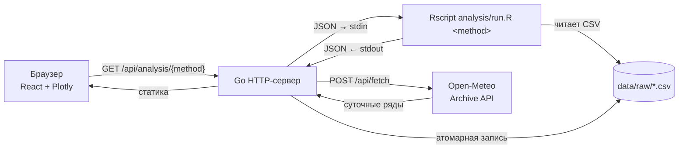

# Архитектура

## Обзор

Приложение — один процесс Go-сервера, который отдаёт собранный фронтенд и REST API. Вся статистика выполняется в R: сервер на каждый (некэшированный) запрос анализа запускает `Rscript` как подпроцесс.



## Компоненты

### Backend (`backend/`, Go, только стандартная библиотека)

| Пакет | Ответственность |
|---|---|
| `cmd/server` | Точка входа: флаги командной строки, сборка зависимостей, запуск `http.Server` |
| `internal/api` | HTTP-обработчики, валидация параметров, фоновая загрузка, раздача SPA |
| `internal/openmeteo` | Клиент Open-Meteo Archive API: формирование запроса, ретраи, проверка структуры ответа |
| `internal/store` | Хранение рядов в CSV (атомарная запись через `.tmp` + `rename`), статистика файла |
| `internal/rrunner` | Запуск `Rscript`, таймаут (120 с), in-memory кэш результатов |

### Analysis (`analysis/`, R, базовый R + `jsonlite`)

| Файл | Содержание |
|---|---|
| `run.R` | Диспетчер: читает JSON из stdin, вызывает метод, пишет JSON в stdout |
| `utils.R` | Загрузка и предобработка рядов, агрегация, тесты Манна–Кендалла и Тейла–Сена |
| `methods.R` | Методы анализа `m_*` — по одному на вкладку интерфейса |
| `install.R` | Установка R-зависимостей в `R_LIBS_USER` |
| `tests/test_stats.R` | Проверка статистических функций на синтетических рядах |

### Frontend (`frontend/`, React 18 + Vite 5 + Plotly)

| Файл | Содержание |
|---|---|
| `src/App.jsx` | Каркас: шапка, вкладки, выбор точки, опрос статуса загрузки |
| `src/api.js` | Обёртка над REST API |
| `src/Plot.jsx` | React-обёртка над Plotly |
| `src/ui.jsx` | Общие UI-компоненты |
| `src/tabs/*.jsx` | Шесть вкладок анализа |

## Поток запроса анализа

1. Фронтенд вызывает `GET /api/analysis/trends?loc=minsk&var=tmean`.
2. `api.analysis` проверяет, что метод есть в белом списке `methods`, оставляет только разрешённые для него параметры и валидирует их (`loc` существует и загружен, `var` из допустимого набора, `k` в диапазоне 2–8).
3. Формируется запрос `{data_dir, locations, params}`, где `locations` — только точки с загруженными данными.
4. `rrunner.Run` ищет результат в кэше по ключу `метод | версия данных | JSON запроса`. Версия данных — список `id:mtime` всех загруженных CSV, поэтому при обновлении любого файла кэш автоматически инвалидируется.
5. При промахе запускается `Rscript --vanilla analysis/run.R trends`, JSON передаётся в stdin. Ответ проверяется на валидность JSON, сохраняется в кэш и отдаётся клиенту как есть.
6. Ошибки R (ненулевой код выхода) возвращаются как HTTP 500 с последними 5 строками stderr.

## Поток загрузки данных

1. `POST /api/fetch` (опционально со списком `ids`) запускает горутину; одновременно может идти только одна загрузка (иначе `409`).
2. Точки загружаются последовательно с паузой 2 с между запросами, чтобы не превышать лимиты бесплатного API.
3. Клиент делает до 5 попыток с квадратичной задержкой (5, 20, 45, 80 с) при сетевых ошибках, HTTP 429 и 5xx.
4. Ответ проверяется: есть `daily.time`, все 8 параметров, длины массивов совпадают.
5. Ряд записывается в `data/raw/<id>.csv` атомарно.
6. Прогресс доступен через `GET /api/status`; фронтенд опрашивает его каждые 3 с.

## Кэширование

- Кэш живёт в памяти процесса и не ограничен по размеру. Для 10 точек это несколько мегабайт.
- После перезапуска сервера кэш пуст; `make warmup` заполняет его заранее, чтобы вкладки открывались мгновенно.
- Холодный расчёт одного метода занимает от долей секунды до нескольких секунд (самый тяжёлый — `trends` без `loc`: Тейл–Сен по всем точкам).

## Структура репозитория

```
.
├── backend/            Go-сервер
│   ├── cmd/server/
│   └── internal/{api,openmeteo,rrunner,store}/
├── analysis/           R-скрипты анализа и тесты
├── frontend/           React-приложение (сборка → frontend/dist)
├── data/
│   ├── locations.json  справочник точек
│   └── raw/            суточные ряды, по CSV на точку
├── docs/               документация
├── Dockerfile
└── Makefile
```

## Решения и компромиссы

Ключевые решения описаны в [ADR](adr/):

- [0001](adr/0001-go-backend-r-analysis.md) — Go для сервера, R для статистики, обмен через stdin/stdout
- [0002](adr/0002-csv-storage.md) — хранение данных в CSV вместо СУБД
- [0003](adr/0003-data-in-repository.md) — исходные данные хранятся в репозитории
